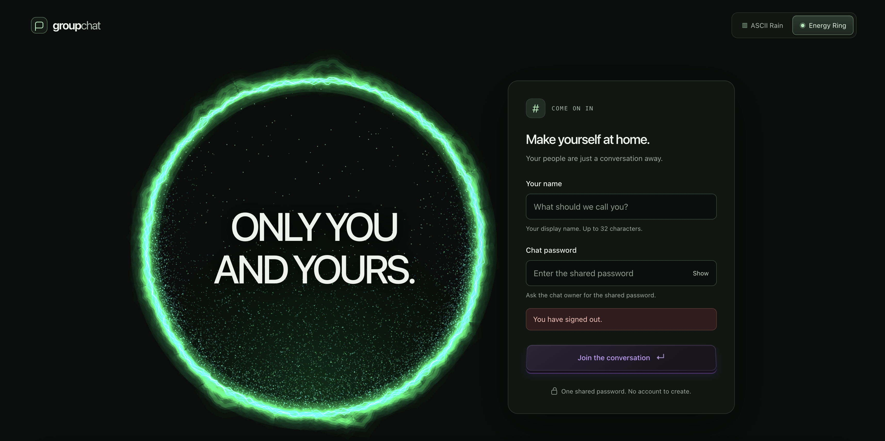
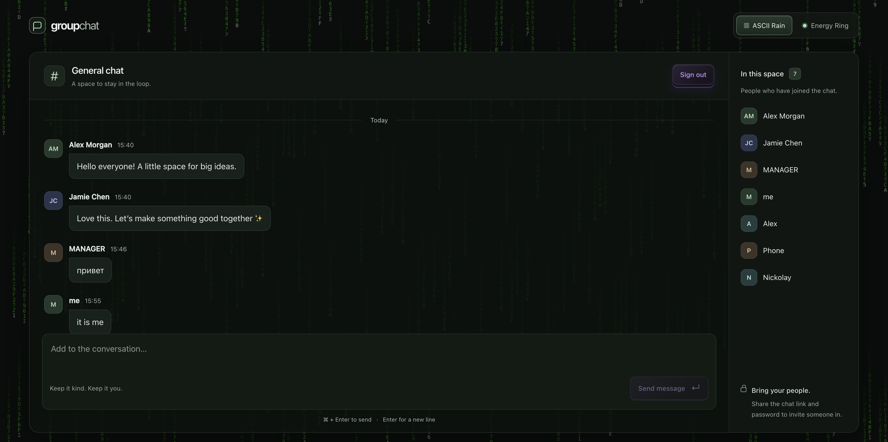

# Group Chat

**ONLY YOU AND YOURS.**

A self-hosted application template for your own group chat. Fork or download it, set a shared password, and invite your people. Built with Java 25, Spring Boot, Gradle Kotlin DSL, and PostgreSQL.

**English** · [Русский](README.ru.md)



## What you can use today

- One shared room with text messages, history, and a participant list.
- A display name and one password for everyone, chosen by the owner. No registration.
- Messages up to 255 characters. Longer drafts show an error and are not sent by the browser.
- Two desktop backgrounds: Energy Ring and ASCII Rain. The selected background is remembered in the browser.
- Responsive mobile layout. Background animation is disabled at mobile widths.
- Send with the button or `Ctrl+Enter` / `⌘+Enter`; `Enter` adds a line break.
- Messages and participants stored in PostgreSQL.



Names are labels, not verified accounts. The same name can be used by different people, and each login creates a new participant. The participant list shows people who have joined, not who is online. Messages and participants currently refresh every two seconds; message history is still loaded in full. This template is a starting point for a small shared chat, with room to adapt the code to your needs.

## Choose how to run it

| Your goal | What you need | Domain needed? |
| --- | --- | --- |
| Try it on your computer | Docker Desktop | No |
| Send a temporary link to a friend | Local Docker + VS Code or Cloudflare Tunnel | No |
| Use your own address from a home computer | Local Docker + a domain + Cloudflare Tunnel | Yes |
| Keep the chat available when your computer is off | A rented VPS + Docker + Caddy + a domain | Yes, for the setup below |

Start with [local Docker](#local-docker). Then choose [VS Code](#vs-code-link), [a temporary Cloudflare link](#cloudflare-link), [a local app with your domain](#local-domain), or [a VPS](#vps). Developers can also [run Java directly](#local-java).

Buying a domain gives you an address, not a running server. For local hosting, the computer, Docker, and tunnel must keep running and the computer must stay awake. For permanent hosting, the VPS runs the application independently of your computer.

<a id="local-docker"></a>
## 1. Run locally with Docker

### Install the tools

Install and start [Docker Desktop](https://docs.docker.com/desktop/) on macOS or Windows. On Linux, install Docker Engine with the Compose plugin; see the [Ubuntu instructions](https://docs.docker.com/engine/install/ubuntu/) or select your distribution there. You do not need a separate Java, Gradle, or PostgreSQL installation for this option.

Open Terminal, PowerShell, or the terminal inside your editor and check:

```bash
docker --version
docker compose version
```

### Download the project

On GitHub, select **Code → Download ZIP** and extract it, or use Git:

```bash
git clone https://github.com/alex-lib/group-chat.git
cd group-chat
```

Run all following Compose commands from the project directory, where `docker-compose.yaml` is located. If you downloaded a ZIP, open a terminal in the extracted folder instead.

### Set your passwords

Copy the example configuration:

```bash
cp .env.example .env
```

Windows PowerShell:

```powershell
Copy-Item .env.example .env
```

Open `.env` in your editor. Replace **both** `change-me` values with your own different passwords:

```dotenv
DB_PASSWORD='replace-with-your-own-database-password'
CHAT_PASSWORD='replace-with-your-own-shared-chat-password'
CHAT_PORT=127.0.0.1:8080
```

The strings above are placeholders, not passwords to reuse. Give participants only `CHAT_PASSWORD`; `DB_PASSWORD` is for the application and database. Keep `.env` private; Git ignores it. Single quotes preserve literal special characters in Compose values; avoid a single quote inside these example quoted values.

The shared password must contain at least 12 characters and no more than 72 UTF-8 bytes. Cyrillic letters and emoji occupy multiple bytes. The supplied `change-me` value is intentionally unsuitable: the app will not start until you replace it.

`CHAT_PORT=127.0.0.1:8080` publishes the app only on your computer. This works with both tunnel options and a reverse proxy installed on the same machine. The example file's plain `CHAT_PORT=8080` publishes on all host interfaces. See [Docker port publishing](https://docs.docker.com/engine/network/port-publishing/).

### Start and open the chat

```bash
docker compose up -d --build
docker compose logs -f app
```

The first build downloads images and dependencies and can take several minutes. Wait for `Started Application`. Press `Ctrl+C` to stop watching the log; the containers continue running.

Open **http://localhost:8080**, enter a display name of 1–32 characters and your shared password, then select **Join chat**. Open a private browser window to try a second participant.

If port 8080 is busy, set `CHAT_PORT=127.0.0.1:18085`, run `docker compose up -d` again, and open http://localhost:18085. Use **18085 instead of 8080** in the forwarding instructions below too.

PostgreSQL runs inside Docker without a published database port. Its tables are created or updated automatically. The browser needs internet access to load jQuery from its CDN.

<a id="vs-code-link"></a>
## 2. Share a link through VS Code — no domain

First start the local chat and check that it opens in your browser.

1. Install [Visual Studio Code](https://code.visualstudio.com/) and open the project folder.
2. Press `⌘⇧P` on macOS or `Ctrl+Shift+P` on Windows/Linux.
3. Run **Ports: Focus on Ports View**.
4. Select **Forward a Port** and enter `8080`, or the host port you configured.
5. Sign in with GitHub if prompted.
6. Right-click the forwarded port and select **Port Visibility → Public**.
7. Copy **Forwarded Address**. Send that HTTPS link and your `CHAT_PASSWORD` to your friend.

Public visibility lets your friend open the link without signing in to your GitHub account; the chat still asks for its own password. Keep VS Code, Docker, and the computer running. See [VS Code port forwarding](https://code.visualstudio.com/docs/debugtest/port-forwarding).

When finished, select **Stop Forwarding Port** in the Ports view. To stop the app too, run `docker compose down`. A stopped or recreated forwarding session may require a new link.

<a id="cloudflare-link"></a>
## 3. Share a temporary Cloudflare link — no domain

Install [cloudflared](https://developers.cloudflare.com/cloudflare-one/networks/connectors/cloudflare-tunnel/downloads/). On macOS with Homebrew:

```bash
brew install cloudflared
```

With the local chat running, open a separate terminal:

```bash
cloudflared tunnel --url http://127.0.0.1:8080
```

Copy the printed `https://...trycloudflare.com` address and share it with your chat password. No domain purchase or Cloudflare account is required for this Quick Tunnel. Keep this terminal open; `Ctrl+C` closes the tunnel. The address changes when you create another tunnel, and availability is not guaranteed. See [Cloudflare Quick Tunnels](https://developers.cloudflare.com/tunnel/get-started/quick-tunnels/).

<a id="local-domain"></a>
## 4. Use your own domain with a local app

Buy a domain from a registrar, add it to Cloudflare, and change its nameservers as instructed there. Install `cloudflared`, then run:

```bash
cloudflared tunnel login
cloudflared tunnel create group-chat
```

Create `~/.cloudflared/config.yml`, replacing the UUID, absolute credentials path, and hostname:

```yaml
tunnel: TUNNEL_UUID
credentials-file: /absolute/path/to/.cloudflared/TUNNEL_UUID.json
ingress:
  - hostname: chat.example.com
    service: http://127.0.0.1:8080
  - service: http_status:404
```

```bash
cloudflared tunnel route dns group-chat chat.example.com
cloudflared tunnel run group-chat
```

Keep the local app and tunnel running. Open `https://chat.example.com`. This uses an outbound tunnel; router port forwarding is unnecessary. Keep tunnel credentials outside Git. For Windows paths and full setup details, follow [Cloudflare's named tunnel guide](https://developers.cloudflare.com/cloudflare-one/networks/connectors/cloudflare-tunnel/do-more-with-tunnels/local-management/create-local-tunnel/).

<a id="vps"></a>
## 5. Deploy on a VPS with a domain and HTTPS

This option keeps the chat running after you turn off your own computer.

### Prepare a server

1. Rent a Linux VPS with a public IP address. Ubuntu 24.04 LTS is one suitable option. Start with at least 2 GB of RAM for a small trial; the Java image build and larger histories may need more. This is a starting configuration, not a capacity guarantee.
2. Save the server IP and SSH credentials supplied by the provider. Prefer SSH keys for access.
3. Connect from your terminal, replacing the placeholders:

   ```bash
   ssh your-user@SERVER_IP
   ```

4. Install [Docker Engine and the Compose plugin](https://docs.docker.com/engine/install/ubuntu/) using the official instructions, or use a provider image with Docker preinstalled. Check `sudo docker compose version`.
5. Install Git if necessary:

   ```bash
   sudo apt update
   sudo apt install -y git
   ```

The VPS commands below use `sudo` for Docker. On your local Docker Desktop installation, use Docker commands without `sudo`.

### Download and configure the chat

```bash
git clone https://github.com/alex-lib/group-chat.git
cd group-chat
cp .env.example .env
nano .env
```

Set your own `DB_PASSWORD` and `CHAT_PASSWORD`, as in the local instructions. Use `CHAT_PORT=127.0.0.1:8080`: Caddy on the server will be the public entry point. Save the file (`Ctrl+O`, `Enter`, `Ctrl+X` in nano).

Create `docker-compose.https.yaml` in the project directory:

```yaml
services:
  app:
    environment:
      SERVER_SERVLET_SESSION_COOKIE_SECURE: "true"
```

Start with both configuration files:

```bash
sudo docker compose -f docker-compose.yaml -f docker-compose.https.yaml up -d --build
sudo docker compose logs -f app
```

The extra file marks the session cookie as HTTPS-only. Merely putting this variable in `.env` would not pass it to the container: it must be declared in `environment`. Keep using **both `-f` arguments** for later `up` and app recreation commands on this deployment. Use the public HTTPS address to sign in.

### Point a domain at the VPS

Buy a domain from a registrar, or use a subdomain of a domain you already own. In its DNS management panel, add:

| Type | Name | Value |
| --- | --- | --- |
| `A` | `chat` | Your VPS public IPv4 address |

For a domain `example.com`, this creates `chat.example.com`. Use the actual domain you own throughout these instructions. Add an `AAAA` record only if the server also has working public IPv6. Wait for DNS changes to propagate. If using Cloudflare DNS for this Caddy setup, start with the record in **DNS only** mode.

In the provider's firewall, allow inbound TCP **80** and **443**. Keep your SSH port allowed (usually 22). Do not publish PostgreSQL or open port 8080 to the internet. If the server also uses UFW, allow your SSH port before enabling it, and allow `80/tcp` and `443/tcp` there as well.

### Configure HTTPS with Caddy

Install Caddy using its [Debian/Ubuntu instructions](https://caddyserver.com/docs/install#debian-ubuntu-raspbian). Edit the configuration:

```bash
sudo nano /etc/caddy/Caddyfile
```

For a new server dedicated to this chat, use:

```caddyfile
chat.example.com {
    reverse_proxy 127.0.0.1:8080
}
```

On a server already hosting other sites, add this block while preserving their configuration. Validate and reload:

```bash
sudo caddy validate --config /etc/caddy/Caddyfile
sudo systemctl reload caddy
```

Caddy obtains and renews a certificate automatically when DNS points to the server and ports 80/443 are reachable. See [Caddy automatic HTTPS](https://caddyserver.com/docs/automatic-https).

Open **https://chat.example.com** and sign in. Share that address and your shared chat password. The Compose services restart automatically unless explicitly stopped; keep Docker and Caddy enabled at system startup. You can now disconnect your SSH session.

For troubleshooting on the server:

```bash
sudo docker compose ps
sudo docker compose logs --tail=100 app db
sudo journalctl -u caddy -n 50 --no-pager
```

<a id="local-java"></a>
## 6. Run with a local JDK or an IDE

Use this for development or an existing PostgreSQL installation. Install **JDK 25** and PostgreSQL; the Docker configuration uses PostgreSQL 19.0. Gradle is included through the Wrapper.

Connect to PostgreSQL as an administrator and create a user and database, substituting your own database password:

```sql
CREATE USER chat WITH PASSWORD 'your-database-password';
CREATE DATABASE chat OWNER chat;
```

On macOS/Linux:

```bash
export DB_URL='jdbc:postgresql://localhost:5432/chat'
export DB_USERNAME='chat'
export DB_PASSWORD='your-database-password'
export CHAT_PASSWORD='your-own-shared-chat-password'
./gradlew bootRun
```

On Windows PowerShell:

```powershell
$env:DB_URL = 'jdbc:postgresql://localhost:5432/chat'
$env:DB_USERNAME = 'chat'
$env:DB_PASSWORD = 'your-database-password'
$env:CHAT_PASSWORD = 'your-own-shared-chat-password'
.\gradlew.bat bootRun
```

Open http://localhost:8080. A local Java run does **not** load `.env`; configure these environment variables in the terminal or your IDE run configuration. Select JDK 25 as the project and Gradle JVM. Set `SERVER_PORT` to change the Java app port; `CHAT_PORT` only configures Docker Compose.

To build and run a JAR instead, with the same environment variables:

```bash
./gradlew bootJar
java -jar build/libs/group-chat-1.0-SNAPSHOT.jar
```

`Ctrl+C` stops a foreground Java run. The VS Code and Cloudflare forwarding options work with this local HTTP server too.

## Stop, update, and manage data

These commands assume the standard local Compose setup. On a VPS, add `sudo`. For an HTTPS deployment, include `-f docker-compose.yaml -f docker-compose.https.yaml` when starting or recreating services.

**Stop the app and database, keeping messages:**

```bash
docker compose down
```

Also stop any VS Code or Cloudflare forwarding session to close its public link. On a VPS, stopping the app stops chat access; Caddy may continue responding with an upstream error until you remove its chat site configuration and reload it.

**Start again:**

```bash
docker compose up -d
```

**Rebuild after updating your code:**

```bash
docker compose up -d --build
```

Back up the database before upgrading. Automatic schema updates are not a replacement for a migration and rollback plan when you change the data model.

**Back up the database** to a file outside the repository (run while the database is running):

```bash
docker compose exec -T db pg_dump -U chat -d chat > ../chat-backup.sql
```

Run this backup command in a macOS/Linux shell (on Windows, use WSL). The file contains chat data: store it privately and copy it off the server. A Docker volume alone is not a backup. For restoration, use PostgreSQL's `psql` against a prepared database; do not import blindly over a populated chat.

**Delete all local messages and participants permanently:**

```bash
docker compose down --volumes
```

Only use this if you intend to erase this Compose deployment's database. Starting again creates an empty database.

**Change the chat password:** edit `CHAT_PASSWORD` in `.env`, then run:

```bash
docker compose up -d --force-recreate app
```

For the VPS HTTPS setup:

```bash
sudo docker compose -f docker-compose.yaml -f docker-compose.https.yaml up -d --force-recreate app
```

Restarting the app ends existing sessions. Participants must enter the new password, but history remains. `docker compose restart` alone does not apply changed environment values.

PostgreSQL sets its user password only when initializing an empty volume. Changing `DB_PASSWORD` in `.env` later does not change the existing database password: update it in PostgreSQL too before recreating the app. Do not erase data merely to change a password.

## Configuration reference

| Variable | Default / requirement | Purpose |
| --- | --- | --- |
| `CHAT_PASSWORD` | Required, 12 characters minimum, 72 UTF-8 bytes maximum | Shared room password |
| `DB_PASSWORD` | Required in Compose | Database password |
| `CHAT_PORT` | `8080` | Docker host binding; use `127.0.0.1:8080` for local/tunnel/proxy setups |
| `DB_URL` | `jdbc:postgresql://localhost:5432/chat` | Local Java database URL; Compose sets its internal URL |
| `DB_USERNAME` | `chat` | Local Java database user; Compose uses `chat` |
| `SERVER_PORT` | `8080` | Local Java HTTP port |
| `SERVER_SERVLET_SESSION_COOKIE_SECURE` | Set to `true` for HTTPS deployment | Pass through Compose `environment` or the Java environment |

Sessions are stored in application memory; restarting the app requires signing in again. HTTPS protects traffic in transit; this is not end-to-end encrypted messaging. The owner has access to the database. Use HTTPS links for internet access and share the chat password only with intended participants.

## Troubleshooting

| Symptom | What to check |
| --- | --- |
| Docker cannot connect to its daemon | Start Docker Desktop or the Docker service. |
| Startup fails with a password error | Replace both `change-me` values; check the chat password length. |
| Port already in use | Set `CHAT_PORT=127.0.0.1:18085` and recreate the app; forward 18085 too. |
| App cannot connect to PostgreSQL | Inspect `docker compose logs db app`; check credentials and whether the volume was initialized with an older password. |
| Forwarded URL does not open | Check localhost first; keep the computer awake and the forwarding process running; copy the current URL. |
| Friend is asked for your GitHub login | Set VS Code port visibility to Public. Do not share your GitHub credentials. |
| Custom HTTPS domain does not work | Check DNS, ports 80/443, Caddy logs, and whether the app is running. |
| Login does not persist over local HTTP | If secure session cookies are enabled, use the HTTPS address. |
| Page loads but controls do not work | Check browser errors and access to the jQuery CDN. |
| Asked to sign in after a restart | Expected: browser sessions are held in application memory. |

## Adapt the template

| What to change | File |
| --- | --- |
| Page structure | [index.html](src/main/resources/static/index.html) |
| Styles and mobile layout | [styles.css](src/main/resources/static/css/styles.css) |
| Browser behavior | [chat.js](src/main/resources/static/js/chat.js) |
| HTTP endpoints | [ChatController.java](src/main/java/org/my/controllers/ChatController.java) |
| Message logic | [ChatService.java](src/main/java/org/my/services/ChatService.java) |
| Participants and shared password | [ChatUserService.java](src/main/java/org/my/services/ChatUserService.java) |
| Access rules | [SecurityConfiguration.java](src/main/java/org/my/configurations/SecurityConfiguration.java) |
| Application settings | [application.yaml](src/main/resources/application.yaml) |

Questions and feature requests: docode@inbox.ru / Telegram: @exceedspace.
