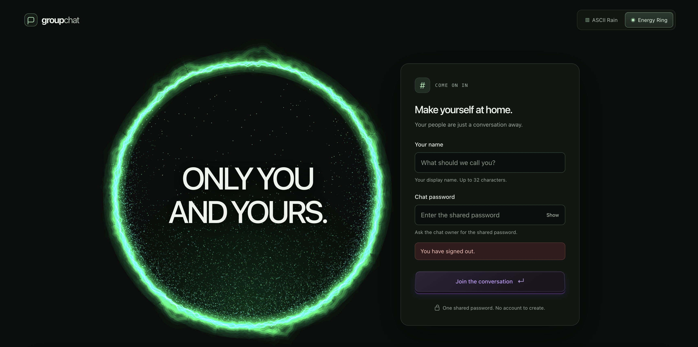
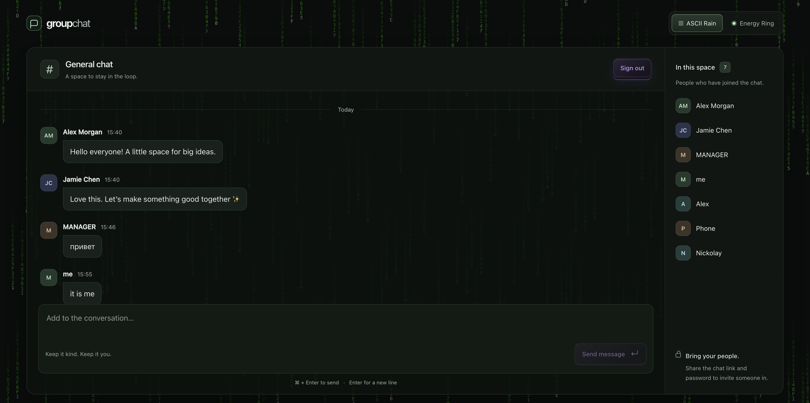

# Group Chat

**ONLY YOU AND YOURS.**

Приложение-шаблон для собственного группового чата.
Скачайте проект или сделайте форк, задайте общий пароль и пригласите своих людей.
В основе — Java 25, Spring Boot, Gradle Kotlin DSL и PostgreSQL.

[English](README.md) · **Русский**



## Что уже работает

- Общая комната с текстовыми сообщениями, историей и списком участников.
- Первый вход с новым именем и общим паролем создаёт пользователя.
- Личный пароль по желанию: измените его в чате и затем входите по имени и этому паролю.
- Сообщения до 255 символов.
  Для более длинного текста браузер показывает ошибку и не отправляет запрос.
- Два фона для компьютера: Energy Ring и ASCII Rain.
  Выбор сохраняется в браузере.
- Адаптация для телефона.
  На мобильной ширине анимация фона отключена.
- Отправка кнопкой или сочетанием `Ctrl+Enter` / `⌘+Enter`; `Enter` переносит строку.
- Хранение сообщений и участников в PostgreSQL.



Общий пароль позволяет новым пользователям присоединиться: не передавайте его за пределы своей группы.
Для существующего имени всегда проверяется сохранённый пароль этого пользователя, в том числе при входе с другого устройства.
Изначально это общий пароль на момент регистрации; менять его на личный необязательно.
После смены пароля общий пароль больше не подходит для этого имени.
Имена учитывают регистр после удаления пробелов по краям и нормализации Unicode.
Список участников показывает тех, кто заходил, а не присутствующих онлайн.
Сначала чат загружает последние 50 сообщений, старые страницы — при прокрутке вверх.
При просмотре последних сообщений новые проверяются раз в две секунды.
Браузер хранит до 300 сообщений; из старой истории можно вернуться кнопкой Back to latest.
Время сообщений соответствует часовому поясу устройства.
Это основа небольшого общего чата, которую можно доработать под свои задачи.

## Выберите способ запуска

| Задача | Что понадобится | Нужен домен? |
| --- | --- | --- |
| Попробовать на своём компьютере | Docker Desktop | Нет |
| Отправить другу временную ссылку | Локальный Docker + VS Code или Cloudflare Tunnel | Нет |
| Использовать свой адрес с домашнего компьютера | Локальный Docker + домен + Cloudflare Tunnel | Да |
| Оставить чат доступным после выключения компьютера | Арендованный VPS + Docker + Caddy + домен | Да, для инструкции ниже |

Начните с [локального запуска через Docker](#local-docker).
Затем выберите [VS Code](#vs-code-link), [временную ссылку Cloudflare](#cloudflare-link), [свой домен для локального приложения](#local-domain) или [VPS](#vps).
Для разработки можно [запустить Java напрямую](#local-java).

Покупка домена даёт адрес, но не сервер.
При локальном размещении компьютер, Docker и туннель должны работать постоянно, а компьютер не должен уходить в сон.
На VPS приложение работает независимо от вашего компьютера.

<a id="local-docker"></a>
## 1. Локальный запуск через Docker

### Установите инструменты

На macOS или Windows установите и запустите [Docker Desktop](https://docs.docker.com/desktop/).
На Linux установите Docker Engine с плагином Compose: [инструкция для Ubuntu](https://docs.docker.com/engine/install/ubuntu/) или другого дистрибутива в том же разделе.
Отдельно устанавливать Java, Gradle и PostgreSQL для этого способа не нужно.

Откройте Terminal, PowerShell или терминал редактора и проверьте:

```bash
docker --version
docker compose version
```

### Скачайте проект

На странице GitHub выберите **Code → Download ZIP** и распакуйте архив.
Если установлен Git:

```bash
git clone https://github.com/alex-lib/group-chat.git
cd group-chat
```

Все дальнейшие команды Compose выполняйте из папки проекта, в которой находится `docker-compose.yaml`.
Если скачали архив, откройте терминал в распакованной папке.

### Задайте пароли

Скопируйте пример конфигурации:

```bash
cp .env.example .env
```

В Windows PowerShell:

```powershell
Copy-Item .env.example .env
```

Откройте `.env` в редакторе.
Замените **оба** значения `change-me` своими разными паролями:

```dotenv
DB_PASSWORD='replace-with-your-own-database-password'
CHAT_PASSWORD='replace-with-your-own-shared-chat-password'
CHAT_PORT=127.0.0.1:8080
```

Строки выше — примеры заполнения, а не готовые пароли.
Участникам передавайте только `CHAT_PASSWORD`; `DB_PASSWORD` нужен приложению для подключения к базе.
Не публикуйте `.env`: этот файл исключён из Git.
Одинарные кавычки сохраняют специальные символы в значениях Compose; в этих примерах не используйте одинарную кавычку внутри самого значения.

Общий пароль должен содержать минимум 12 символов и занимать не более 72 байт в UTF-8.
Кириллица и эмодзи занимают несколько байт.
Исходное значение `change-me` намеренно не подходит: без его замены приложение не запустится.

`CHAT_PORT=127.0.0.1:8080` открывает приложение только на вашем компьютере.
Этого достаточно для туннелей и обратного прокси на той же машине.
Простое `CHAT_PORT=8080` из файла-примера публикует порт на всех интерфейсах компьютера.
Подробнее — [публикация портов Docker](https://docs.docker.com/engine/network/port-publishing/).

### Запустите и откройте чат

```bash
docker compose up -d --build
docker compose logs -f app
```

При первой сборке скачиваются образы и зависимости; это может занять несколько минут.
Дождитесь строки `Started Application`.
Нажмите `Ctrl+C`, чтобы выйти из просмотра логов: контейнеры продолжат работать.

Откройте **http://localhost:8080**, введите имя длиной 1–32 символа и свой общий пароль, нажмите **Join chat**.
Если имя новое, будет создан пользователь; для существующего имени нужен его сохранённый пароль.
Для второго участника откройте приватное окно браузера.

Если порт 8080 занят, укажите `CHAT_PORT=127.0.0.1:18085`, выполните `docker compose up -d` и откройте http://localhost:18085.
В инструкциях по публикации ниже тоже используйте **18085 вместо 8080**.

PostgreSQL работает внутри Docker без публикации порта базы данных.
Таблицы создаются или обновляются автоматически.
Браузеру нужен доступ в интернет для загрузки jQuery с CDN.

<a id="vs-code-link"></a>
## 2. Ссылка через VS Code — без покупки домена

Сначала запустите чат локально и убедитесь, что он открывается в браузере.

1. Установите [Visual Studio Code](https://code.visualstudio.com/) и откройте папку проекта.
2. Нажмите `⌘⇧P` на macOS или `Ctrl+Shift+P` на Windows/Linux.
3. Выполните **Ports: Focus on Ports View**.
4. Нажмите **Forward a Port**, введите `8080` или выбранный вами порт.
5. Если потребуется, войдите через GitHub.
6. Нажмите правой кнопкой на порт → **Port Visibility → Public**.
7. Скопируйте **Forwarded Address** и отправьте другу HTTPS-ссылку вместе с вашим `CHAT_PASSWORD`.

Режим Public позволяет другу открыть ссылку без входа в ваш GitHub; пароль самого чата всё равно потребуется.
VS Code, Docker и компьютер должны оставаться включёнными.
Подробнее — [проброс портов в VS Code](https://code.visualstudio.com/docs/debugtest/port-forwarding).

Когда закончите, выберите **Stop Forwarding Port** в панели Ports.
Чтобы остановить и приложение, выполните `docker compose down`.
После остановки или повторного создания проброса может понадобиться новая ссылка.

<a id="cloudflare-link"></a>
## 3. Временная ссылка Cloudflare — без покупки домена

Установите [cloudflared](https://developers.cloudflare.com/cloudflare-one/networks/connectors/cloudflare-tunnel/downloads/).
На macOS с Homebrew:

```bash
brew install cloudflared
```

При работающем локальном чате откройте отдельный терминал:

```bash
cloudflared tunnel --url http://127.0.0.1:8080
```

Скопируйте выведенный адрес `https://...trycloudflare.com` и отправьте его вместе с паролем чата.
Для Quick Tunnel не нужны домен и аккаунт Cloudflare.
Терминал должен оставаться открытым; `Ctrl+C` закрывает туннель.
При новом запуске адрес меняется, постоянная доступность не гарантируется.
Подробнее — [Cloudflare Quick Tunnels](https://developers.cloudflare.com/tunnel/get-started/quick-tunnels/).

<a id="local-domain"></a>
## 4. Свой домен для локального приложения

Купите домен у регистратора, добавьте его в Cloudflare и смените серверы имён по инструкции сервиса.
Установите `cloudflared` и выполните:

```bash
cloudflared tunnel login
cloudflared tunnel create group-chat
```

Создайте `~/.cloudflared/config.yml`, подставив UUID, абсолютный путь к файлу учётных данных и свой адрес:

```yaml
tunnel: TUNNEL_UUID
credentials-file: /absolute/path/to/.cloudflared/TUNNEL_UUID.json
ingress:
  - hostname: chat.example.com
    service: http://127.0.0.1:8080
  - service: http_status:404
```

```bash
cloudflared tunnel route dns group-chat chat.example.com
cloudflared tunnel run group-chat
```

Оставьте приложение и туннель запущенными.
Откройте `https://chat.example.com`.
Проброс портов на роутере не нужен: туннель устанавливает исходящее соединение.
Не добавляйте учётные данные туннеля в Git.
Пути для Windows и подробные шаги — в [инструкции Cloudflare](https://developers.cloudflare.com/cloudflare-one/networks/connectors/cloudflare-tunnel/do-more-with-tunnels/local-management/create-local-tunnel/).

<a id="vps"></a>
## 5. Развёртывание на VPS с доменом и HTTPS

При таком размещении чат продолжит работать после выключения вашего компьютера.

### Подготовьте сервер

1. Арендуйте Linux VPS с публичным IP-адресом.
   Подойдёт, например, Ubuntu 24.04 LTS.
   Для небольшой пробной установки начните с 2 ГБ оперативной памяти; сборка Java-образа и большая история могут потребовать больше.
   Это начальная конфигурация, а не гарантия определённой нагрузки.
2. Сохраните IP и данные SSH, выданные провайдером.
   Для входа предпочтительнее SSH-ключи.
3. Подключитесь из терминала, заменив значения своими:

   ```bash
   ssh your-user@SERVER_IP
   ```

4. Установите [Docker Engine и плагин Compose](https://docs.docker.com/engine/install/ubuntu/) по официальной инструкции или выберите образ провайдера с готовым Docker.
   Проверьте `sudo docker compose version`.
5. При необходимости установите Git:

   ```bash
   sudo apt update
   sudo apt install -y git
   ```

Команды Docker для VPS ниже используют `sudo`.
При работе с локальным Docker Desktop оно не требуется.

### Скачайте и настройте чат

```bash
git clone https://github.com/alex-lib/group-chat.git
cd group-chat
cp .env.example .env
nano .env
```

Задайте свои `DB_PASSWORD` и `CHAT_PASSWORD`, как в локальной инструкции.
Укажите `CHAT_PORT=127.0.0.1:8080`: публичный доступ обеспечит Caddy на сервере.
Сохраните файл: в nano это `Ctrl+O`, `Enter`, `Ctrl+X`.

Создайте в папке проекта файл `docker-compose.https.yaml`:

```yaml
services:
  app:
    environment:
      SERVER_SERVLET_SESSION_COOKIE_SECURE: "true"
```

Запустите приложение с обоими файлами конфигурации:

```bash
sudo docker compose -f docker-compose.yaml -f docker-compose.https.yaml up -d --build
sudo docker compose logs -f app
```

Дополнительный файл разрешает отправку cookie сессии только через HTTPS.
Одной записи этой переменной в `.env` недостаточно: её нужно передать контейнеру через `environment`.
При последующих командах `up` и пересоздании приложения используйте **оба аргумента `-f`**.
Входите через публичный HTTPS-адрес.

### Направьте домен на VPS

Купите домен у регистратора или используйте поддомен своего существующего домена.
В панели управления DNS добавьте запись:

| Тип | Имя | Значение |
| --- | --- | --- |
| `A` | `chat` | Публичный IPv4 вашего VPS |

Для домена `example.com` получится адрес `chat.example.com`.
Во всех примерах замените его своим настоящим адресом.
Запись `AAAA` добавляйте только при работающем публичном IPv6 на сервере.
Дождитесь обновления DNS.
Если DNS обслуживает Cloudflare, для этой схемы с Caddy начните с режима **DNS only**.

В межсетевом экране провайдера разрешите входящий TCP на порты **80** и **443**.
Сохраните доступ к SSH-порту, обычно 22.
Не публикуйте PostgreSQL и не открывайте 8080 в интернет.
Если дополнительно используется UFW, перед его включением разрешите свой SSH-порт, а также добавьте правила для `80/tcp` и `443/tcp`.

### Настройте HTTPS через Caddy

Установите Caddy по [инструкции для Debian/Ubuntu](https://caddyserver.com/docs/install#debian-ubuntu-raspbian).
Откройте конфигурацию:

```bash
sudo nano /etc/caddy/Caddyfile
```

Для нового сервера, выделенного под этот чат:

```caddyfile
chat.example.com {
    reverse_proxy 127.0.0.1:8080
}
```

Если сервер уже обслуживает другие сайты, добавьте блок, сохранив их настройки.
Проверьте конфигурацию и примените её:

```bash
sudo caddy validate --config /etc/caddy/Caddyfile
sudo systemctl reload caddy
```

Caddy автоматически получает и продлевает сертификат, когда DNS указывает на сервер, а порты 80/443 доступны извне.
Подробнее — [автоматический HTTPS в Caddy](https://caddyserver.com/docs/automatic-https).

Откройте **https://chat.example.com** и войдите.
Передайте участникам этот адрес и общий пароль.
Сервисы Compose перезапускаются автоматически, если их не остановили явно; Docker и Caddy должны быть включены в автозапуск системы.
SSH-соединение можно закрыть.

Диагностика на сервере:

```bash
sudo docker compose ps
sudo docker compose logs --tail=100 app db
sudo journalctl -u caddy -n 50 --no-pager
```

<a id="local-java"></a>
## 6. Запуск через локальный JDK или IDE

Этот способ подходит для разработки или подключения к уже установленной PostgreSQL.
Установите **JDK 25** и PostgreSQL; конфигурация Docker использует PostgreSQL 19.0.
Gradle уже доступен через Wrapper в проекте.

Подключитесь к PostgreSQL с правами администратора и создайте пользователя и базу, заменив пароль своим:

```sql
CREATE USER chat WITH PASSWORD 'your-database-password';
CREATE DATABASE chat OWNER chat;
```

На macOS/Linux:

```bash
export DB_URL='jdbc:postgresql://localhost:5432/chat'
export DB_USERNAME='chat'
export DB_PASSWORD='your-database-password'
export CHAT_PASSWORD='your-own-shared-chat-password'
./gradlew bootRun
```

В Windows PowerShell:

```powershell
$env:DB_URL = 'jdbc:postgresql://localhost:5432/chat'
$env:DB_USERNAME = 'chat'
$env:DB_PASSWORD = 'your-database-password'
$env:CHAT_PASSWORD = 'your-own-shared-chat-password'
.\gradlew.bat bootRun
```

Откройте http://localhost:8080.
При прямом запуске Java файл `.env` **не загружается**: задайте переменные в терминале или конфигурации запуска IDE.
Выберите JDK 25 для проекта и Gradle JVM.
Для смены порта Java-приложения используйте `SERVER_PORT`; `CHAT_PORT` относится только к Docker Compose.

Чтобы собрать и запустить JAR с теми же переменными окружения:

```bash
./gradlew bootJar
java -jar build/libs/group-chat-1.0-SNAPSHOT.jar
```

`Ctrl+C` останавливает Java-приложение, запущенное в терминале.
Проброс через VS Code и Cloudflare работает и с этим локальным HTTP-сервером.

## Остановка, обновление и данные

Далее приведены команды для стандартного локального Compose.
На VPS добавляйте `sudo`.
Для HTTPS-развёртывания при запуске и пересоздании сервисов указывайте `-f docker-compose.yaml -f docker-compose.https.yaml`.

**Остановить приложение и базу, сохранив сообщения:**

```bash
docker compose down
```

Также остановите проброс VS Code или туннель Cloudflare, чтобы закрыть публичную ссылку.
На VPS после остановки приложения чат недоступен, но Caddy может отвечать ошибкой подключения к приложению, пока вы не удалите блок чата из его конфигурации и не примените изменения.

**Запустить снова:**

```bash
docker compose up -d
```

**Пересобрать после обновления кода:**

```bash
docker compose up -d --build
```

Перед обновлением сделайте резервную копию базы.
Автоматическое обновление схемы не заменяет план миграции и отката при изменении модели данных.

**Создать резервную копию базы** вне репозитория, пока база работает:

```bash
docker compose exec -T db pg_dump -U chat -d chat > ../chat-backup.sql
```

Команду резервного копирования выполняйте в оболочке macOS/Linux; на Windows используйте WSL.
Файл содержит переписку: храните его приватно и копируйте за пределы сервера.
Сам Docker volume не является резервной копией.
Для восстановления используйте PostgreSQL `psql` с подготовленной базой; не импортируйте копию поверх заполненного чата без проверки.

**Безвозвратно удалить все сообщения и участников этого развёртывания:**

```bash
docker compose down --volumes
```

Выполняйте только если действительно хотите удалить базу этого проекта Compose.
При следующем запуске создастся пустая база.

**Изменить общий пароль:** отредактируйте `CHAT_PASSWORD` в `.env` и выполните:

```bash
docker compose up -d --force-recreate app
```

Для HTTPS на VPS:

```bash
sudo docker compose -f docker-compose.yaml -f docker-compose.https.yaml up -d --force-recreate app
```

Перезапуск приложения завершает существующие сессии.
Изменённый общий пароль применяется к новым регистрациям.
Существующие пользователи сохраняют свои пароли, включая первоначальный общий пароль, если они его не меняли.
История сохраняется.
Простая команда `docker compose restart` не применяет изменённые переменные окружения.

PostgreSQL задаёт пароль пользователя только при инициализации пустого volume.
Последующая замена `DB_PASSWORD` в `.env` не меняет пароль существующей базы: измените его и в PostgreSQL перед пересозданием приложения.
Удалять данные ради смены пароля не нужно.

## Смена своего пароля

Войдите в чат, нажмите **Password** в его шапке и введите текущий пароль, новый пароль и подтверждение.
Новый пароль должен содержать минимум 12 символов и занимать не более 72 байт UTF-8.
В PostgreSQL хранятся только хеши паролей.
После успешной смены ваши сессии на всех устройствах завершатся; войдите заново с прежним именем и новым паролем.
Пароли и сессии других пользователей не изменятся.
Смена личного пароля не меняет общий пароль для новых регистраций.
Самостоятельного восстановления пароля пока нет, поэтому сохраните личный пароль в надёжном месте.

## Переменные конфигурации

| Переменная | По умолчанию / требование | Назначение |
| --- | --- | --- |
| `CHAT_PASSWORD` | Обязательна: минимум 12 символов, максимум 72 байта UTF-8 | Начальный пароль для новых регистраций |
| `DB_PASSWORD` | Обязательна в Compose | Пароль базы |
| `CHAT_PORT` | `8080` | Публикация порта Docker; для локального запуска, туннеля и прокси — `127.0.0.1:8080` |
| `DB_URL` | `jdbc:postgresql://localhost:5432/chat` | URL базы для Java; Compose задаёт внутренний адрес |
| `DB_USERNAME` | `chat` | Пользователь базы для Java; Compose использует `chat` |
| `SERVER_PORT` | `8080` | HTTP-порт при прямом запуске Java |
| `SERVER_SERVLET_SESSION_COOKIE_SECURE` | `true` для HTTPS-развёртывания | Передаётся через Compose `environment` или окружение Java |

Сессии хранятся в памяти приложения: после перезапуска нужно войти заново.
HTTPS защищает передачу данных, но чат не использует сквозное шифрование.
Владелец имеет доступ к базе.
Для доступа через интернет используйте HTTPS, а общий пароль передавайте только приглашённым участникам.

## Если что-то не работает

| Симптом | Что проверить |
| --- | --- |
| Docker не может подключиться к daemon | Запустите Docker Desktop или службу Docker. |
| При старте ошибка пароля | Замените оба `change-me`, проверьте длину пароля чата. |
| Порт уже занят | Укажите `CHAT_PORT=127.0.0.1:18085`, пересоздайте приложение, пробрасывайте тоже 18085. |
| Приложение не подключается к PostgreSQL | Посмотрите `docker compose logs db app`; проверьте пароли и не был ли volume создан со старым паролем. |
| Внешняя ссылка не открывается | Сначала проверьте localhost; компьютер не должен спать, проброс должен работать; скопируйте актуальный URL. |
| У друга запрашивается ваш GitHub | Переключите видимость порта VS Code на Public. Не передавайте данные своего GitHub. |
| Свой HTTPS-домен недоступен | Проверьте DNS, порты 80/443, логи Caddy и работу приложения. |
| Вход не сохраняется по локальному HTTP | При включённых secure cookie используйте HTTPS-адрес. |
| Страница открылась, но кнопки не работают | Проверьте ошибки браузера и доступ к CDN jQuery. |
| После перезапуска снова нужен пароль | Это ожидаемо: сессии хранятся в памяти приложения. |

Вопросы и предложения: docode@inbox.ru / Telegram: @exceedspace.
